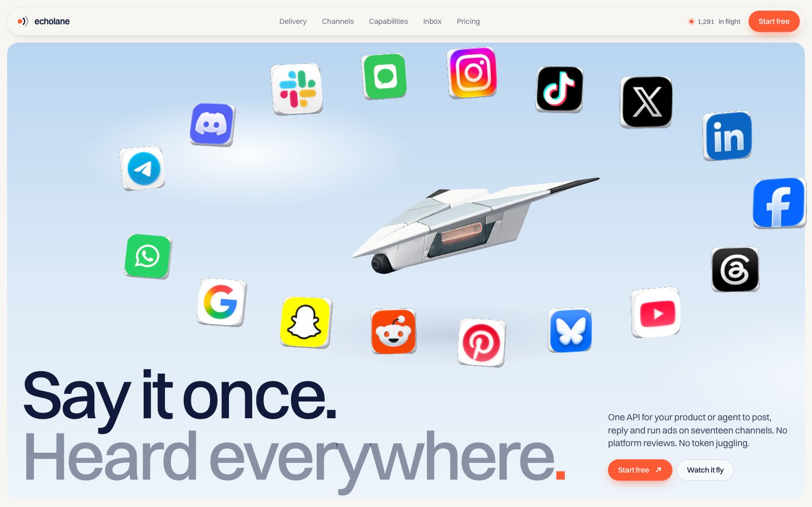

# Echolane

A 3D storytelling landing page for a fictional API that lets a product or AI agent post, reply and run ads on 17 channels at once. Built with Three.js, Lenis and plain HTML, CSS and JavaScript.

**Live:** https://echolane-pentaclay-concept.vercel.app



## What it shows

A paper-glider 3D model flies through the page and points at what to read next. One message goes out, and you watch it land on every channel.

- A textured glTF glider that follows the scroll, with Three.js lighting
- Smooth scrolling with Lenis
- A live delivery board with flip-style status updates
- Channel cards, capabilities, a shared inbox demo and pricing
- Works on mobile and respects reduced motion

## Files

```
index.html          the whole site: markup, styles and scripts
img/                channel icons, author photo, scene image
img/glider/         the 3D glider model (.glb)
docs/               README preview image
```

## Run it locally

No build step and no install. It is one HTML file. Three.js loads from a CDN.

```bash
git clone https://github.com/pentaclay/echolane.git
cd echolane
python3 -m http.server 8000
```

Open http://localhost:8000. Use a local server, not `file://`, because the browser blocks module imports and model loading from plain files.

Deploy it anywhere that serves static files: Vercel, Netlify, GitHub Pages, Cloudflare Pages.

## Notes

Echolane is a fictional company. Numbers and quotes are illustrative. The glider model was generated with AI for this project. Channel logos belong to their owners and are used only to show which networks the concept supports.

## Made by

**Erfan** at [Pentaclay](https://pentaclay.com). We design storytelling websites for AI companies.

- Email: [contact@pentaclay.com](mailto:contact@pentaclay.com)
- Book a 30 min call: [cal.com/pentaclay/discovery-call](https://cal.com/pentaclay/discovery-call)
- LinkedIn: [linkedin.com/in/kazierfan](https://www.linkedin.com/in/kazierfan)
- X: [@pentaclay](https://x.com/pentaclay)
- Dribbble: [dribbble.com/pentaclay](https://dribbble.com/pentaclay)

Want a site like this for your product? Email or book a call.

## License

MIT. See [LICENSE](LICENSE). Use it, change it, ship it. A link back is nice but not required.
